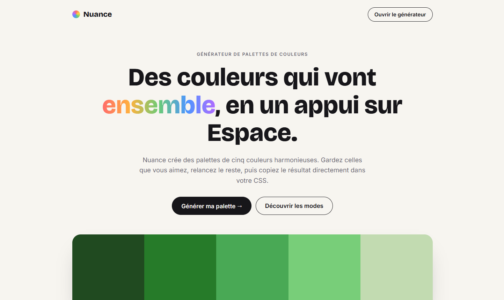

# Nuance · Générateur de palettes

> Jour 01 du défi **30 jours, 30 projets** · HTML, CSS et JavaScript, sans bibliothèque

Nuance génère des palettes de couleurs harmonieuses en un appui sur Espace. On garde les couleurs qui plaisent, on relance le reste, puis on copie le résultat directement dans son CSS.

🔗 **Démo :** [nuancecolor.netlify.app](https://nuancecolor.netlify.app/)

## Fonctionnalités

**Générer**

- **5 modes d'harmonie** : aléatoire, analogue, complémentaire, triadique et monochrome.
- **Couleurs triées par teinte** : les couleurs proches restent côte à côte, y compris les rouges situés de part et d'autre de la roue des couleurs.
- **Verrouillage** 🔒 : une couleur verrouillée est gardée, et la palette suivante est construite autour de sa teinte.
- Raccourci **Espace** pour générer une nouvelle palette.

**Personnaliser**

- **Un nom pour chaque couleur** (Corail, Bleu nuit, Émeraude…), choisi automatiquement et modifiable.
- **De 2 à 10 couleurs** : ajouter, supprimer, ou modifier une couleur avec le sélecteur du navigateur.
- **Glisser-déposer** pour réordonner les couleurs, à la souris ou au doigt.

**Exporter et partager**

- **Copie en un clic** du code hexadécimal.
- **Export CSS** en variables nommées : `--corail`, `--bleu-nuit`…
- **Export PNG** de la palette, avec les noms et les codes.
- **Partage par lien** : les couleurs et leurs noms sont dans l'adresse de la page.

**Couleur du jour**

- Une couleur différente chaque jour, la même pour tout le monde, calculée à partir de la date.
- Une courte description générée selon sa teinte, sa saturation et sa luminosité, ses nuances, et un lien pour créer une palette autour d'elle.

L'interface est pensée pour le mobile : bouton « Générer » fixé en bas de l'écran, menu déroulant pour les outils.

## Structure

| Fichier | Rôle |
| --- | --- |
| `index.html` | Page vitrine : présentation, couleur du jour, modes, fonctionnalités |
| `generator.html` | Le générateur |
| `palette.js` | Logique des couleurs, partagée : conversions HSL ↔ hexadécimal, modes, tri, noms, couleur du jour |
| `script.js` | Interface du générateur : rendu, verrouillage, glisser-déposer, exports, partage |
| `landing.js` | Animations et contenus dynamiques de la page vitrine |
| `style.css` | Styles des deux pages |

## Lancer en local

Aucune installation : ouvrir `index.html` dans le navigateur.

La copie dans le presse-papier peut être bloquée quand la page est ouverte directement depuis un fichier. Dans ce cas, servir le dossier, par exemple avec l'extension **Live Server** de VS Code ou `npx serve .`.

## Technologies

HTML, CSS et JavaScript, sans bibliothèque ni étape de construction. Seules les polices viennent de Google Fonts (Bricolage Grotesque et Inter).
